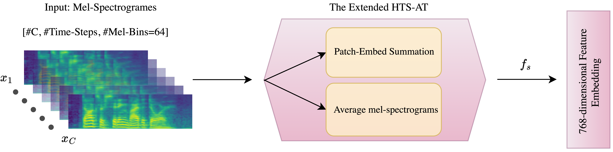
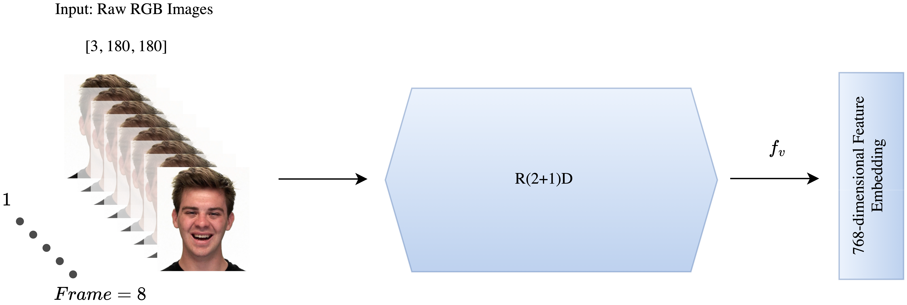
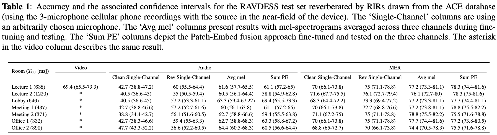

# Multi-Microphone and Multi-Modal Emotion Recognition in Reverberant Environments - Accepted to EUSIPCO 2025

🔥 **Official repository PyTorch-Lightning code for the paper:**  
**"Multi-Microphone and Multi-Modal Emotion Recognition in Reverberant Environments"** (EUSIPCO 2025)  
This work is an extension of our previous paper, [**"Multi-Microphone Speech Emotion Recognition using the Hierarchical Token-semantic Audio Transformer Architecture"**](https://ieeexplore.ieee.org/document/10887873) (ICASSP 2025). It adds multi-modal learning to further improve robustness.  
📄 [Read the Paper (IEEE Xplore)](https://ieeexplore.ieee.org/document/11226096) | [arXiv](https://arxiv.org/pdf/2409.09545)  

🍎 **New (11/2026):** the code now also runs on Apple-silicon Macs, on the [`mac-port`](https://github.com/OhadCohen97/Multi-Microphone-Multi-Modal-Emotion-Recognition-in-Reverberant-Environments/tree/mac-port) branch (setup and steps are in that branch's README). Note that the Mac version builds its data with different RIR processing from the paper, and uses its own actor split, so its results are not directly comparable to the paper's:
- the training rooms are simulated with pyroomacoustics instead of gpuRIR, with each microphone placed independently;
- every RIR is cut at the direct path, and the ACE RIRs are resampled to 16 kHz.


---

## 🔍 Overview
Human emotions are conveyed through **speech and facial expressions**, making **multi-modal emotion recognition (MER)** crucial for robust emotion classification. This work introduces a **multi-microphone and multi-modal system** combining:

- **HTS-AT Transformer** for multi-channel audio processing
- **R(2+1)D ResNet CNN** for video-based emotion recognition
- **Late fusion concatenation** to combine audio & video features

### 🔮 Key Features
✔️ **Multi-Microphone Audio Processing**: Robust against reverberation  
✔️ **Multi-Modal Learning**: Combines speech and facial cues  
✔️ **Tested on RAVDESS convolved with Real-World RIRs** (ACE Database)  
✔️ **Pretrained Models Available** for Fine-Tuning and testing

---

## 📸 Model Architecture
Our approach consists of **two main components**:
1. **HTS-AT Transformer (Audio Modality)**:
   - Processes **multi-channel mel-spectrograms**
   - Uses **Patch-Embed Summation & Averaging strategies**
   - Extracts **deep features** for robust emotion classification
2. **R(2+1)D CNN (Video Modality)**:
   - Extracts spatiotemporal features from facial expressions
   - Pretrained on **Kinetics dataset**, fine-tuned for MER
3. **Feature Fusion & Classification**:
   - Late fusion via **concatenation of extracted embeddings**
   - Fully connected layers for final emotion classification

| Multi-channel Multi-modal Architecture | Multi-Microphone Audio | Video-Based Recognition |
|----------------------|------------------|----------------------|
|  |  |  |

---

## 🔧 Getting Started

### **1️⃣ Installation**
The base way to run the code is with Docker Container.
#### **Pull Docker Image**
```bash
docker pull ohadico97/mer:v1
```
After having the image, run:

```bash
docker run -it --gpus all --shm-size 20G -v $HOME:$HOME --name <container name> ohadico97/mer:v1
```
#### **Clone the Repository**
```bash
git clone https://github.com/OhadCohen97/Multi-Microphone-Multi-Modal-Emotion-Recognition-in-Reverberant-Environments.git
cd Multi-Microphone-Multi-Modal-Emotion-Recognition-in-Reverberant-Environments
```
#### **Use the Virtual Environment**
```bash
Python 3.8.13 ('base')
```

---

### **2️⃣ Dataset Setup**
The previous paper evaluated the models on three datasets: **RAVDESS**, **IEMOCAP**, and **CREMA-D**. In this work, we focus exclusively on the **RAVDESS** dataset. The **training and validation splits** are reverberated synthetically using the **'gpuRIR' Python library**, while the **test sets** are reverberated with real-world ACE RIRs recorded in various acoustic environments. You can choose which modality to fine-tune using the ```multimodal``` flag in ```config.py```.
- 🔗 [Dataset & Pre-trained Models](https://www.dropbox.com/scl/fo/px0lqliq9kc53tpv2smf2/AGnCptxxQBvGsigrih7urbU?rlkey=cxtlcus07oka82xvfruz8t5cw&st=2lm1tbt9&dl=0)

**Note** that the first work fine-tuned on different amounts of samples and splits.

Place datasets inside `data/` folder:
```bash
MER/
  │── data/
        │── <dataset name & type>/
                   │── train.npy
                   │── val.npy
                   │── test.npy
│── ACE/
      │── <dataset name>
            │── MP1/
                  │── Lecture_room_1_508
                        │── train.npy
                        │── val.npy
                        │── test.npy
                  │── Lecture_room_2_403a
                        │── train.npy
                        │── val.npy
                        │── test.npy
                  │── lobby
                     ...
                  │── Meeting room_2 _611
                  │── Office_1_502
                  │── Office_2_803
```

---

### **3️⃣ Training & Evaluation**
#### **Preprocess Data**
For preprocess the data see the notebooks.
#### **Fine-tune the Models**
First, in ```config.py```, make sure you have the HTS-AT AudioSet pre-trained model and the path to it. Set the root path to the dataset you wish to use.
To train:
```bash
CUDA_VISIBLE_DEVICES=0,1,2,3,4 python3 main.py train
```
#### **Evaluate Performance**
To evaluate the models, set the paths for the npy files. See in ```main.py test_ace (lines 219,236,253) ```.

```bash
CUDA_VISIBLE_DEVICES=0,1,2,3,4 python3 main.py test_ace
```
For a single test run on one npy file:

```bash
CUDA_VISIBLE_DEVICES=0,1,2,3,4 python3 main.py test
```

---

## 📊 Results


---

## 🏆 Citation
If you use this work, please cite:
```bibtex
@inproceedings{cohen2025mer,
  title={Multi-Microphone and Multi-Modal Emotion Recognition in Reverberant Environment},
  author={Cohen, Ohad and Hazan, Gershon and Gannot, Sharon},
  booktitle={2025 33rd European Signal Processing Conference (EUSIPCO)},
  pages={940--944},
  year={2025},
  doi={10.23919/EUSIPCO63237.2025.11226096}
}
```
and the first paper:
```bibtex
@inproceedings{cohen2025ser,
  title={Multi-Microphone Speech Emotion Recognition Using the Hierarchical Token-Semantic Audio Transformer Architecture},
  author={Cohen, Ohad and Hazan, Gershon and Gannot, Sharon},
  booktitle={ICASSP 2025 - 2025 IEEE International Conference on Acoustics, Speech and Signal Processing (ICASSP)},
  pages={1--5},
  year={2025},
  doi={10.1109/ICASSP49660.2025.10887873}
}
```

---

## 🌟 Acknowledgments
This research was supported by the **European Union’s Horizon 2020 Program** and the **Audition Project, Data Science Program, Israel**.

---

## 👤 Contact
For questions or collaborations, feel free to reach out:  
📧 **ohad.cohen@biu.ac.il**

